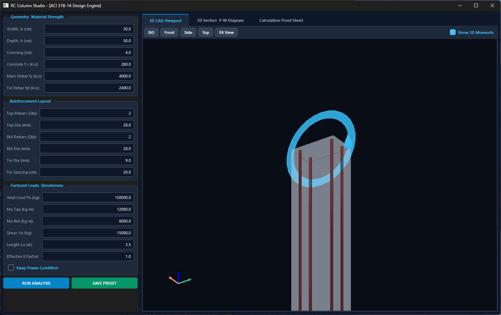
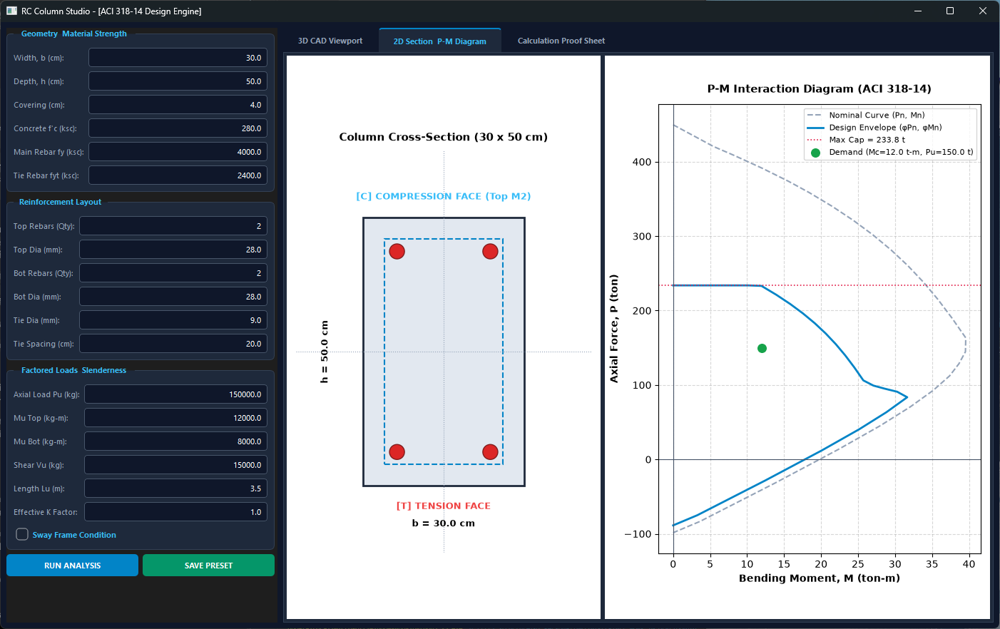
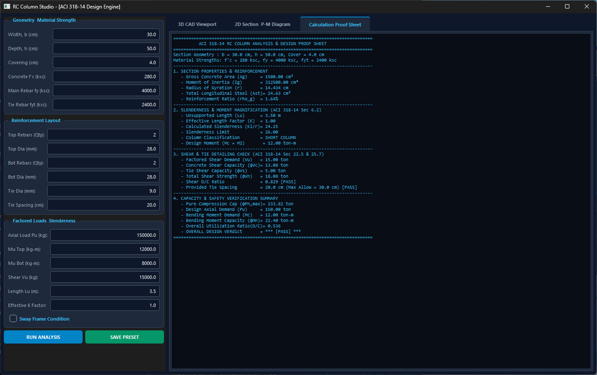

# RC Column Studio - ACI 318-14 Design Engine

[](https://www.python.org)
[](https://pypi.org/project/PySide6/)
[](https://docs.pyvista.org/)
[](LICENSE)

A Python desktop application for analyzing and designing reinforced concrete columns according to ACI 318-14. It features a decoupled architecture, real-time 3D rendering, P-M interaction diagram sweeps, and slenderness magnification.

---

## 1. Interactive 3D CAD Viewport



A custom 3D viewport built specifically for vertical columns, providing clear visual feedback:

- **Dynamic 3D Bending Moments:** Shows the direction of applied bending moments ($M_{top}$ and $M_{bot}$) using scaled 3D circular arrows. The arrows automatically orient based on the moment's sign.
- **Transparent Concrete Body:** Renders the concrete body as semi-transparent (opacity=0.35) so you can clearly see the internal longitudinal rebars and check the clear cover distance.
- **Z-Up Camera Engine:** Uses a custom Z-Up camera system. It allows smooth panning and orbital rotation centered directly on the column model.

---

## 2. 2D Section & P-M Interaction Diagram



The core engine uses strain compatibility and force equilibrium to check the section capacity:

- **Real-time Cross-Section:** Automatically identifies and labels the Compression [C] and Tension [T] faces based on the applied moments. It draws the accurate 2D section boundaries, rebar coordinates, and tie perimeters.
- **P-M Curve Sweeper:** Calculates 80 equilibrium points by sweeping the neutral axis depth ($c$) from $3.0h$ down to $0.05h$ to build smooth Nominal and Design curves.
- **Smart $\phi$-Factor Transition:** Adjusts the strength reduction factor ($\phi$) automatically. It interpolates from 0.65 (compression-controlled) to 0.90 (tension-controlled) based on the outermost tension steel strain ($\epsilon_t$).
- **Capacity Capping:** Applies ACI limits for maximum axial compression ($\phi P_{n,max} = 0.80 \times 0.65 P_0$ for tied columns) and pure tension ($\phi P_{nt}$).
- **Demand Verification:** Plots the load demand point ($M_c, P_u$) directly on the diagram so you can easily see if the column passes or fails.

---

## 3. Slenderness & Shear Engine

Evaluates slenderness effects and checks shear capacity based on ACI 318-14 provisions.

- **Slenderness Magnification:** Checks the slenderness ratio against the limit `min(40, 34 + 12(M1/M2))` for non-sway frames. If the column is slender, it calculates the magnified design moment ($M_c$) using the magnifier:
  $$\delta_{ns} = \frac{C_m}{1 - P_u / (0.75 P_c)}$$
- **Axial-Dependent Shear Capacity:** Adjusts the concrete shear strength ($V_c$) based on the applied axial load. It increases $V_c$ for compression ($P_u > 0$) using the multiplier `1 + Pu / (140 Ag)`. For tension ($P_u < 0$), it decreases the capacity using `1 + Pu / (35 Ag)`.
- **Tie Spacing Limits:** Verifies the provided tie spacing against ACI detailing limits ($16d_b$, $48d_t$, and the least cross-sectional dimension).

---

## 4. Calculation Proof Sheet



Generates a step-by-step ASCII text report to help verify the calculation pipeline:

- Outputs gross section properties ($A_g, I_g, r$) and reinforcement ratio ($\rho_g$).
- Summarizes slenderness classification, critical buckling load ($P_c$), and moment magnification steps.
- Displays the Demand/Capacity (D/C) ratio and the final pass/fail status for both shear and flexural checks.

---

## 5. Preset Configuration

The application uses `Pydantic` for strict data validation and schema management. You can save your current GUI inputs and reload them automatically on the next startup. The configuration is stored as a standard JSON file (`column_preset.json`) in the root directory.

---

## 6. Engineering Boundaries & Limitations

- **Uniaxial Bending Only:** The engine currently sweeps the P-M curve for single-axis bending. It does not support 3D biaxial bending interaction surfaces.
- **Rectangular Sections:** Limited to solid rectangular sections ($b \times h$). Circular columns with spiral ties are not currently supported.
- **Moment Magnification:** Relies on the ACI moment magnifier method ($\delta_{ns}$) to account for slenderness. It does not perform a complete 2nd-order ($P-\Delta$) frame analysis.

---

## Installation & Usage

**Requirements:** Python 3.8+

1. Install the required dependencies:
    ```bash
    pip install -r requirements.txt
    ```

2. Run the application:
    ```bash
    python main_gui.py
    ```

---

## Author

**ARIYA**  
Structural engineer & developer of RC Column Studio.

## License

Distributed under the MIT License. See `LICENSE` for details.